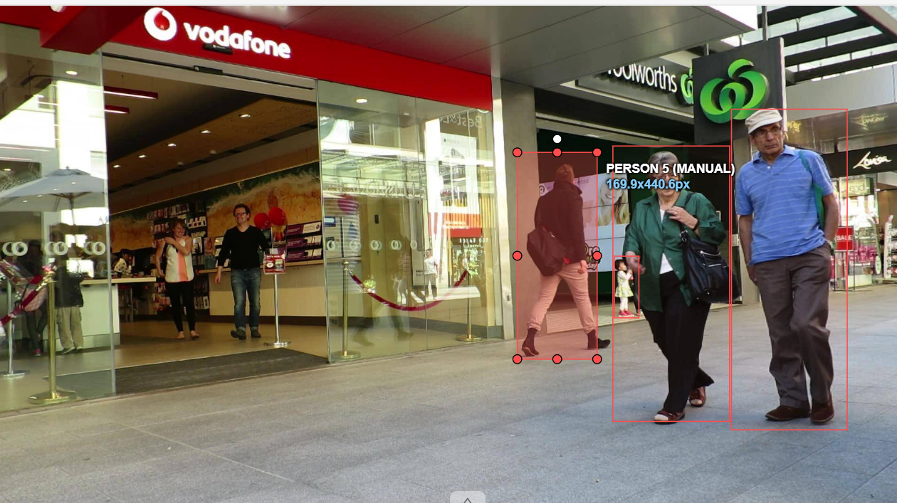
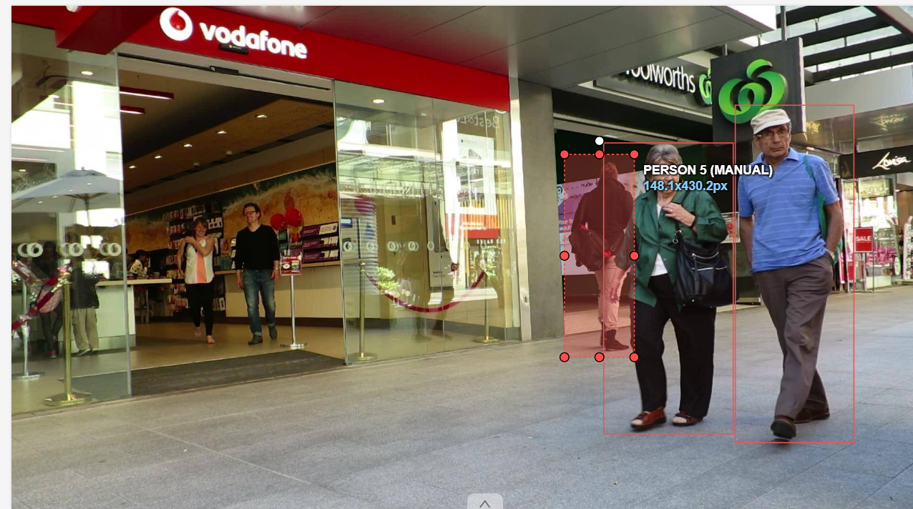
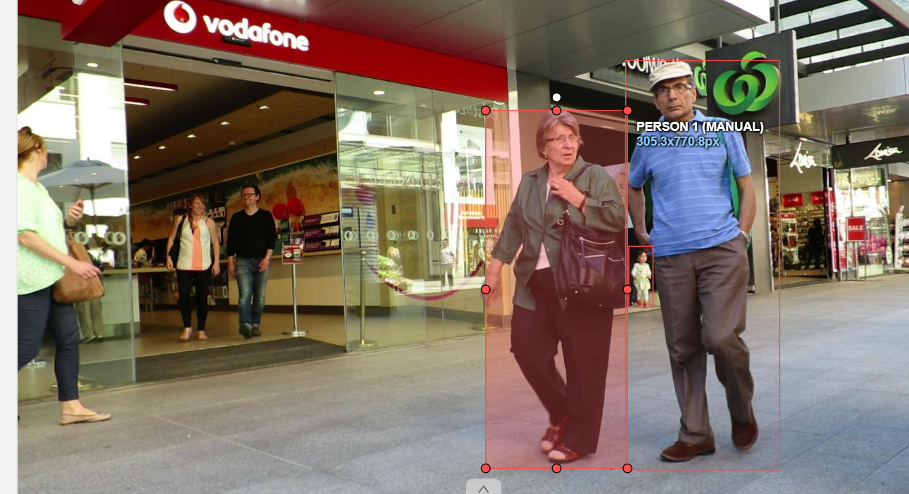

# Báo cáo cá nhân — LeQuangVinh-2A202604059

Đoạn video: MOT17-09, 150 frame (frame 1–150), nguồn MOTChallenge, giấy phép CC BY-NC-SA 3.0.

## 0. Thông tin học viên

* Họ tên: Lê Quang Vinh
* MSSV: 2A202604059
* Mã đề (A/B/C): A
* Email: 26ai.vinhlq@vinuni.edu.vn
* Link repository: https://github.com/v1nhleee/K5-L2b-LeQuangVinh-2A202604059-MOTTracking
* Giờ bắt đầu: 16:00
* Giờ kết thúc: 19:30

## 1. Xem trước đoạn video (CP0)

Ghi **trước khi vẽ**, mỗi người một dòng *(số frame ghi theo `gt.txt`: 1–150, tương ứng frame 0–149 trên CVAT)*.

| Mã | Frame xuất hiện | Frame cuối thấy được | Rẽ / dừng / đổi tốc độ ở frame | Bị che ở frame | Ghi chú |
| --- | --- | --- | --- | --- | --- |
| P1 | 1 | 150 | 32, 62, 101, 120 | Không bị che | Người phụ nữ mặc áo khoác xanh, đeo túi đen đi bộ từ phải sang trái hướng về phía camera |
| P2 | 1 | 150 | 42, 65, 83, 117 | 1–64 | Người đàn ông mặc áo polo xanh, đội mũ trắng đi cùng P1; lúc đầu bị cắt một phần ở mép phải khung hình |
| P3 | 1 | 105 | 21, 89 | 90–105 | Người phụ nữ (mẹ của P4) đi phía sau; bị P1 và P2 đi ngang qua che khuất hoàn toàn từ frame 106 |
| P4 | 1 | 147 | 21, 106, 137 | 107–136 | Em bé mặc váy trắng đi cạnh P3; bị che khuất hoàn toàn trong đoạn 111–136 rồi lộ diện lại ở khoảng giữa P1 và P2 |
| P5 | 1 | 137 | 22, 37, 62, 83, 129 | 36–137 | Người đàn ông mặc áo khoác đen đeo túi đi phía sau bên trái; bị P1 che khuất một phần và khuất hẳn ở đoạn 122–128 |

## 2. Keyframe và thời gian (CP1, CP4)

Số keyframe lấy từ kết quả `src/check_submission.py` *(chỉ số frame trong ngoặc hiển thị theo CVAT 0–149)*.

| Mã | Số keyframe | Keyframe ở frame | Số frame có mặt | Keyframe / 100 frame | Thời gian (phút) | Chỗ khó |
| --- | --- | --- | --- | --- | --- | --- |
| P1 | 20 | `[0, 10, 20, 31, 41, 51, 61, 71, 81, 91, 100, 110, 118, 122, 123, 125, 130, 138, 139, 149]` | 150 | 13.3 | 30 | Tiến lại gần camera nên kích thước bounding box tăng dần liên tục |
| P2 | 26 | `[0, 10, 20, 30, 41, 43, 47, 52, 60, 64, 66, 70, 76, 82, 89, 100, 110, 115, 118, 120, 124, 128, 137, 138, 140, 148]` | 150 | 17.3 | 35 | Giai đoạn đầu (0–63) bị cắt sát mép phải ảnh, cần ước lượng phần thân bị khuất |
| P3 | 6 | `[0, 10, 20, 30, 89, 100]` | 105 | 5.7 | 15 | Đứng xa camera, kích thước nhỏ và bị P1 che khuất dần trước khi mất hẳn |
| P4 | 9 | `[0, 10, 20, 30, 50, 106, 136, 140, 145]` | 121 | 7.4 | 25 | Bị che khuất hoàn toàn 26 frame rồi xuất hiện lại ở khe hẹp giữa P1 và P2 |
| P5 | 28 | `[0, 10, 20, 30, 34, 36, 37, 40, 41, 51, 60, 67, 70, 77, 78, 82, 85, 89, 90, 100, 106, 110, 113, 116, 118, 119, 120, 128]` | 130 | 21.5 | 45 | Di chuyển chéo phía sau P1, bị che khuất một phần kéo dài và đổi tốc độ/hướng |
| **Tổng** | **89** | — | **656** | **13.6** | **150** | — |

Keyframe / 100 frame của cả bài = tổng keyframe ÷ tổng số frame có mặt × 100 = $89 \div 656 \times 100 = 13.6$.

Bạn đặt keyframe nhiều nhất ở người nào? Vì sao (người đó rẽ, dừng, lại gần camera hay bị che)?

Đặt keyframe nhiều nhất ở **P5 (28 keyframe, đạt 21.5 KF/100 frame)** vì đối tượng này vừa đi từ mép trái vào sâu bên trong khung hình (thay đổi kích thước và tốc độ rõ rệt), vừa bị **P1 che khuất một phần trong thời gian dài (56 frame)** nên cần đặt nhiều keyframe để căn chỉnh chính xác phần cơ thể bị khuất, tránh hiện tượng trôi box (`drift`) và đánh dấu đúng các mốc bật/tắt `occluded` và `outside`.

## 3. Đoạn bị che (CP2)

Người bị che: `P4` *(em bé đứng cạnh mẹ)*

| Mốc | Frame |
| --- | --- |
| Bắt đầu bị che một phần (bật `occluded`) | 107 *(frame 107 trên CVAT)* |
| Mất hẳn (bật `outside`) | 111 *(frame 111 trên CVAT)* |
| Hiện lại (tắt `outside`) | 137 *(frame 137 trên CVAT)* |
| Thấy rõ trở lại (tắt `occluded`) | *(frame 141 trên CVAT)* |

- Thời gian khuất hẳn: 29 frame = 0.97 giây.
- Quyết định: giữ cùng ID (`Track ID 4`).
- Lý do (trả lời 3 câu: khuất bao lâu so với 60 frame, ngoại hình có khớp, chỗ hiện lại có đúng hướng và tốc độ):
  1. **Thời gian khuất so với ngưỡng 60 frame:** Đối tượng chỉ khuất hoàn toàn trong khoảng 29 frame ($\approx 0.97$ giây), ngắn hơn nhiều so với ngưỡng quy định là 60 frame (2 giây).
  2. **Ngoại hình khớp:** Khi lộ diện trở lại, em bé vẫn giữ nguyên đặc điểm nhận dạng và trang phục (váy sáng màu) ban đầu.
  3. **Hướng và tốc độ di chuyển:** Vị trí và hướng xuất hiện lại hoàn toàn đồng bộ với quỹ đạo di chuyển ở khu vực cạnh người mẹ trước đó.

Ảnh chụp màn hình:





## 4. Tự review ID (CP3)

Lượt 1 theo người (đi ngược từ frame 149 về 0 trên CVAT), lượt 2 theo cảnh (nhảy 10 frame). Ít nhất 3 dòng; không có lỗi thì ghi một dòng "đã kiểm hai lượt, không lỗi".

Loại lỗi dùng đúng một trong 7 mã: `id_switch`, `fragmentation`, `lost`, `merge`, `false_track`, `drift`, `flag`.

| Frame | Mã người | Loại lỗi | Mô tả một câu | Phát hiện ở lượt | Đã sửa? |
| --- | --- | --- | --- | --- | --- |
| — | — | — | Đã kiểm hai lượt (lượt 1 đi ngược từ frame 149 về 0 theo từng người, lượt 2 nhảy bước 10 frame theo toàn cảnh), không lỗi. | Lượt 1 & Lượt 2 | Không có lỗi |

Tổng hợp số lỗi theo loại:

| `id_switch` | `fragmentation` | `lost` | `merge` | `false_track` | `drift` | `flag` |
| --- | --- | --- | --- | --- | --- | --- |
| 0 | 0 | 0 | 0 | 0 | 0 | 0 |

Lỗi nào chỉ lượt 2 (theo cảnh) mới thấy, lượt 1 (theo người) không thấy? Vì sao?

Các lỗi mang tính tương tác giữa nhiều đối tượng trong cùng một khung hình như **`id_switch`** (nhảy nhầm ID giữa hai người đi lướt qua nhau), **`merge`** (hai box gộp nhầm vào cùng một người), **`false_track`** (box ảo nằm trơ trọi khi người đã đi khuất) hoặc sai lệch trạng thái **`flag`** (`occluded`/`outside` giữa người đứng trước và người đứng sau) chỉ lượt 2 (kiểm theo toàn cảnh) mới dễ phát hiện. Lý do là khi kiểm lượt 1 theo từng người riêng lẻ, người gán chỉ tập trung vào quỹ đạo của một box duy nhất nên dễ bỏ qua sự chồng lấn hoặc tráo đổi nhãn với các đối tượng xung quanh tại cùng một thời điểm.

## 5. File xuất và kết quả tự kiểm (CP4)

| Kiểm tra | Kết quả |
| --- | --- |
| Tên file MOT 1.1 | `src/exports/LeQuangVinh_mot.zip` |
| Tên file CVAT for video 1.1 | `src/exports/LeQuangVinh_cvat_video.zip` |
| Số track ID khác nhau trong `gt/gt.txt` (phải là 5) | `5` |
| Frame `outside` không có dòng trong `gt.txt` (đúng / sai) | `Đúng` |
| Job đã completed trên CVAT máy cá nhân | `Đã chuyển trạng thái sang completed` |

Dán phần tóm tắt in ra từ `src/check_submission.py`:

```text
Số frame in theo CVAT (bắt đầu từ 0). Trong gt.txt, frame_id = frame CVAT + 1.

=== File MOT 1.1: LeQuangVinh_mot.zip ===
  Số track ID: 5   |   Tổng số box: 656
  [OK]        Đúng 5 track ID.

  Track | Frame có mặt | Số frame | Đoạn vắng (outside)
      1 |   0–149      |      150 | -
      2 |   0–149      |      150 | -
      3 |   0–104      |      105 | -
      4 |   0–146      |      121 | 110–135
      5 |   0–136      |      130 | 121–127


=== File CVAT for video 1.1: LeQuangVinh_cvat_video.zip ===

  Track | Nhãn   | Frame thấy | Keyframe | KF/100 frame | Frame occluded | Lần bật outside
      0 | person |        150 |       20 |         13.3 |              0 |               0
              Track 0: keyframe ở frame [0, 10, 20, 31, 41, 51, 61, 71, 81, 91, 100, 110, 118, 122, 123, 125, 130, 138, 139, 149]
      1 | person |        150 |       26 |         17.3 |             64 |               0
              Track 1: keyframe ở frame [0, 10, 20, 30, 41, 43, 47, 52, 60, 64, 66, 70, 76, 82, 89, 100, 110, 115, 118, 120, 124, 128, 137, 138, 140, 148]
      2 | person |        105 |        6 |          5.7 |             16 |               1
              Track 2: keyframe ở frame [0, 10, 20, 30, 89, 100]
      3 | person |        121 |        9 |          7.4 |             10 |               2
              Track 3: keyframe ở frame [0, 10, 20, 30, 50, 106, 136, 140, 145]
      4 | person |        130 |       28 |         21.5 |             56 |               2
              Track 4: keyframe ở frame [0, 10, 20, 30, 34, 36, 37, 40, 41, 51, 60, 67, 70, 77, 78, 82, 85, 89, 90, 100, 106, 110, 113, 116, 118, 119, 120, 128]

  Tổng: 89 keyframe / 656 frame có mặt = 13.6 keyframe / 100 frame
  [OK]        Đọc được 5 track từ annotations.xml.

=== Tóm tắt ===
  Lỗi: 0   |   Cảnh báo: 0 
  Đạt. Dán phần tóm tắt này vào báo cáo mục 5.
```

## 6. Ba câu kết

1. Nếu được gán lại, bạn sẽ đặt keyframe khác ở đâu? Vì sao?
   Nếu được gán lại, em sẽ giảm bớt các keyframe đặt định kỳ mỗi 10 frame ở những đoạn đối tượng di chuyển thẳng đều (như P1 và P2 ở đoạn frame 0–30 hoặc P5 ở đoạn 40–60) vì phép nội suy tuyến tính của CVAT đã bám rất sát. Thay vào đó, em sẽ tập trung đặt keyframe dày hơn ở những thời điểm đối tượng **bắt đầu đổi hướng, đổi tốc độ đột ngột hoặc vừa bước ra khỏi vùng bị che khuất** (như P4 tại frame 136 và P5 tại frame 128) để tiết kiệm thời gian mà vẫn giữ độ chính xác IoU cao.

2. Có chỗ nào bạn không chắc "cùng ID hay ID mới"? Bạn đã quyết định và ghi chú thế nào?
   Có hai tình huống gây phân vân là **P4 (em bé váy trắng)** bị P1 và P2 che khuất hoàn toàn trong **26 frame** (từ frame 110 đến 135 trên CVAT) và **P5 (người đàn ông áo đen)** khuất hẳn sau P1 trong **7 frame** (frame 121–127 trên CVAT). Sau khi đối chiếu quy tắc ngưỡng **60 frame ($2\text{ giây}$)** và kiểm tra sự trùng khớp về trang phục cũng như hướng di chuyển khi lộ diện lại, em quyết định bật `outside` trong đoạn khuất và **giữ nguyên cùng Track ID cũ** cho cả hai đối tượng, đồng thời ghi chú rõ mốc frame vào bảng CP0 và mục 3.

3. Một lỗi ID trong job của bạn (nếu không còn sót, chọn lỗi đã sửa) có thể làm xe tự lái dự đoán sai chuyển động của người đó như thế nào? Lỗi đó ảnh hưởng MOTA hay IDF1 nhiều hơn?
   Nếu xảy ra lỗi **`id_switch`** giữa P1 (người phụ nữ đi ngang từ phải sang trái ở tiền cảnh) và P5 (người đàn ông đi chếch phía sau) khi hai người giao nhau, bộ dự đoán quỹ đạo của xe tự lái sẽ tính toán sai vector vận tốc (tưởng rằng người đi bộ đang đổi hướng đột ngột hoặc tăng tốc cắt ngang đầu xe), dẫn đến việc xe phanh gấp không cần thiết hoặc đánh lái sai hướng. Lỗi `id_switch` này sẽ làm giảm mạnh chỉ số **`IDF1`** nhiều hơn **`MOTA`**, vì `MOTA` chỉ phạt một lần tại frame xảy ra chuyển đổi ID, trong khi `IDF1` đánh giá tính nhất quán danh tính xuyên suốt toàn bộ chuỗi thời gian nên toàn bộ các frame sau điểm nhảy ID đều bị tính là sai định danh.

## 7. Tài liệu tham khảo và công cụ AI đã dùng

* Tài liệu hướng dẫn thực hành Lab Day 05 — Multi-Object Tracking (MOT17-09) trên CVAT.
* Bộ dữ liệu MOTChallenge (MOT17-09), giấy phép CC BY-NC-SA 3.0.
* Công cụ hỗ trợ: Sử dụng AI (Gemini) để giải đáp quy tắc gắn cờ `occluded`/`outside` trên giao diện CVAT, đối chiếu số liệu thống kê từ `gt.txt` và rà soát cấu trúc trình bày báo cáo cá nhân.
